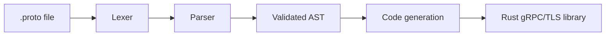

# Protobuf to gRPC Library Generator (Rust)

A static code generator written in Rust that turns a `.proto` contract into a complete,
tested and TLS-secured Rust gRPC library, ready to use between cloud services.

> Internship project (summer 2026), ENET'Com Sfax x ProgressBox.
> The source code is private. This repository presents the design, the results and what I learned.

## What it does

A developer provides a `.proto` file. The tool validates the contract, then generates a
standalone Cargo crate containing the gRPC client and server code, which builds, tests and packages automatically.

## Key features

- **Hand-written lexer and parser** with precise syntax errors reported with line numbers
- **Abstract syntax tree with semantic validation** (for example duplicate fields, unknown RPC types), so no invalid or partial output is ever generated
- **Complete Rust library generation**: message structs, gRPC client and server interfaces, packaged as a standalone Cargo crate
- **Real gRPC transport** with Tonic, secured with **TLS** (rustls)
- **Validation-only (lint) mode** for fast checks in continuous integration
- **CI/CD pipeline** (GitLab) that builds, tests and packages the generated library, with deployment through systemd

## Cloud proof of concept

Two independent services, generated from the same library, communicate continuously
(Service A queries Service B every 5 seconds over gRPC/HTTP2), supervised by a real-time monitoring dashboard.

| Measure | Result |
|---|---|
| Average latency (10 requests) | **0.874 ms** (min 0.748 ms, max 1.001 ms) |
| Recovery after a simulated crash (`kill -9`) | **under 3 seconds**, automatic restart by systemd |
| Load test | 25 closely spaced requests (200 ms interval) absorbed without degradation |

## Testing and methodology

Work organized in **6 Scrum sprints**, with one rule applied without exception:
*no feature is complete until I have seen it run for real.*

| Indicator | Value |
|---|---|
| Automated unit tests | 23 |
| Documented manual checks | 40+ |
| Sprints tested and validated | 6 / 6 |

## Tech stack

Rust · Cargo · Tonic · Tokio · Protobuf · gRPC · TLS (rustls) · Clap · GitLab CI/CD · systemd

## Known limitations

- Deployment automation relies on a local script, a choice made for a single-machine proof of concept
- TLS certificates are intentionally not generated by the tool: generating cryptographic material in a generic tool is not good security practice, so this is left to the deployment environment

## What I learned

Compiler design (lexer, parser, AST), systems programming and async Rust,
distributed service architecture, CI/CD practices, and Scrum-based project management.

## Author

**Assar Zahmoul**, engineering student in Electronic Systems and Communication, ENET'Com Sfax
[LinkedIn](https://www.linkedin.com/in/assar-zahmoul-492a75337)
